# 📝 Лабораторная работа 5. Сборка системы

> **Студент:** Кузнецова Елизавета, БИСО-01-24
>
> **Вариант:** 20 – смешанный поток PIPE + JSON Lines, автоопределение формата каждой строки; обязательные приёмники: консоль и файл.
>
> **Репозиторий:** [Ссылка на GitHub](https://github.com/Allureeee/LogHub-workshop)  
> **Pull Request:** [Ссылка на Pull Request](https://github.com/Allureeee/LogHub-workshop/pull/6)

## 🎯 Задача

Завершить существующий LogHub: собирать импортёр, конвейер и согласованные приёмники из конфигурации, подключить несовместимые SQL- и JSON-интерфейсы, добавить обёртки доставки и составные правила фильтрации. Сохранить смешанный вход, консоль и файл варианта 20, а также цепочку, посетителей, наблюдателей и посредника из ЛР4. Скрыть сборку за фасадом и проверить новые механизмы без обращения тестов к диску, сети и базе данных.

## 📊 Диаграмма классов

Обзорная диаграмма создания и выполнения системы приведена ниже. Детали разделены на 12 тематических исходников PlantUML в `docs/diagrams/ЛР5/`: фабрики и семейства, строители, прототипы, адаптеры, декораторы, заместители, составные правила, модели посетителей, наблюдатели, конвейер с посредником, граф и унаследованные приёмники. Такое разделение сохраняет читаемость: вместо одной перегруженной схемы в репозитории лежат самостоятельные диаграммы подсистем.

В диаграммах показаны вручную объявленные классы и интерфейсы приложения; компиляторные машины состояний, неявный класс `Program` и тестовые двойники не считаются типами предметной модели. Сплошные стрелки на обзоре обозначают хранимые ссылки, пунктирные – использование при создании или выполнении. Исходники PlantUML присутствуют в репозитории.

**`all-classes.puml`**:

```plantuml
@startuml 01_facade_builders
title LogHub LR5 - facade builders
left to right direction
skinparam classAttributeIconSize 0
hide empty members
class "LogHubApplication" as LogHubApplication
class "BuiltPipeline" as BuiltPipeline {
  +Run(showGraph): ProcessingResult
  +Dispose(): void
}
interface "IPipelineConstruction" as IPipelineConstruction {
  +Reset(configuration): void
  +BuildSource(): void
  +BuildProcessing(): void
  +BuildOutputs(): void
  +GetResult(): BuiltPipeline
}
class "PipelineBuilder" as PipelineBuilder {
  +Configure(configuration): PipelineBuilder
  +FromFile(path, importer): PipelineBuilder
  +FromSource(source, importer): PipelineBuilder
  +FilterWith(rule): PipelineBuilder
  +WriteTo(sink): PipelineBuilder
  +Build(): BuiltPipeline
}
class "PipelineDirector" as PipelineDirector {
  +BuildDefault(): BuiltPipeline
  +Build(configuration): BuiltPipeline
}
class "PipelinePlan" as PipelinePlan
class "StandardPipelineBuilder" as StandardPipelineBuilder
class "CompositionRoot" as CompositionRoot <<static>>
class "LogHub" as LogHub <<static>> {
  {static} +Run(configuration, resources, showGraph): ProcessingResult
  {static} +Run(args): int
}
class "GraphDemo" as GraphDemo <<other page>>
interface "IConfigService" as IConfigService <<other page>>
interface "IHubResources" as IHubResources <<other page>>
interface "ILogImporter" as ILogImporter <<other page>>
interface "ILogRule" as ILogRule <<other page>>
interface "ILogSink" as ILogSink <<other page>>
interface "ITextSource" as ITextSource <<other page>>
class "LogConfiguration" as LogConfiguration <<other page>>
class "LogProcessor" as LogProcessor <<other page>>
class "PipelineReport" as PipelineReport <<other page>>
class "PipelineSinkLifetime" as PipelineSinkLifetime <<other page>>
BuiltPipeline --> LogHubApplication : _application
IPipelineConstruction <|.. StandardPipelineBuilder
LogHubApplication --> GraphDemo : _graphDemo
LogHubApplication --> IConfigService : _config
LogHubApplication --> LogProcessor : _processor
LogHubApplication --> PipelineReport : _report
LogHubApplication --> PipelineSinkLifetime : _sinks
PipelineBuilder --> IHubResources : _resources
PipelineBuilder --> ILogImporter : _importer
PipelineBuilder --> ILogRule : _rule
PipelineBuilder --> ILogSink : _sinks
PipelineBuilder --> ITextSource : _source
PipelineBuilder --> LogConfiguration : _configuration
PipelineDirector --> IPipelineConstruction : _builder
PipelinePlan --> IHubResources : Resources
PipelinePlan --> ILogImporter : Importer
PipelinePlan --> ILogRule : Rule
PipelinePlan --> ILogSink : Sinks
PipelinePlan --> ITextSource : Source
PipelinePlan --> LogConfiguration : Configuration
StandardPipelineBuilder --> IHubResources : _resources
StandardPipelineBuilder --> LogConfiguration : Configuration
StandardPipelineBuilder --> LogConfiguration : _configuration
StandardPipelineBuilder --> PipelineBuilder : Builder
StandardPipelineBuilder --> PipelineBuilder : _builder
PipelineBuilder ..> CompositionRoot : builds from plan
CompositionRoot ..> BuiltPipeline : creates owned product
LogHub ..> PipelineDirector : classic build
LogHub ..> PipelineBuilder : fluent build
legend bottom
Solid arrow: stored field/property reference.
Dotted arrow: creation or temporary use.
Triangle: inheritance or interface implementation.
Other-page nodes are detailed elsewhere in this atlas.
endlegend
@enduml

@startuml 02_importer_factories
title LogHub LR5 - importer factories
left to right direction
skinparam classAttributeIconSize 0
hide empty members
class "ImporterFactoryRegistry" as ImporterFactoryRegistry {
  +Get(name): LogImporterFactory
}
class "JsonImporterFactory" as JsonImporterFactory
abstract class "LogImporterFactory" as LogImporterFactory {
  +Name: string
  {abstract} +Create(source, parser): ILogImporter
}
class "MemoryImporterFactory" as MemoryImporterFactory
class "MixedImporterFactory" as MixedImporterFactory
interface "ILogImporter" as ILogImporter
class "ImportItem" as ImportItem <<record>>
class "ImportSession" as ImportSession
class "InMemoryLogImporter" as InMemoryLogImporter
class "JsonLogImporter" as JsonLogImporter
abstract class "LogImporterBase" as LogImporterBase
class "MixedLogImporter" as MixedLogImporter
class "FileTextSource" as FileTextSource
interface "ITextSource" as ITextSource
class "InMemoryTextSource" as InMemoryTextSource
class "LogParser" as LogParser <<other page>>
ILogImporter <|.. LogImporterBase
ITextSource <|.. FileTextSource
ITextSource <|.. InMemoryTextSource
ImportSession --> ILogImporter : _strategy
ImportSession --> ImportItem : _iterator
ImporterFactoryRegistry --> LogImporterFactory : _factories
InMemoryLogImporter --> LogParser : _parser
JsonLogImporter --> LogParser : _parser
LogImporterBase --> ITextSource : _source
LogImporterBase <|-- InMemoryLogImporter
LogImporterBase <|-- JsonLogImporter
LogImporterBase <|-- MixedLogImporter
LogImporterFactory <|-- JsonImporterFactory
LogImporterFactory <|-- MemoryImporterFactory
LogImporterFactory <|-- MixedImporterFactory
MixedLogImporter --> LogParser : _parser
MixedImporterFactory ..> MixedLogImporter : creates
JsonImporterFactory ..> JsonLogImporter : creates
MemoryImporterFactory ..> InMemoryLogImporter : creates
legend bottom
Solid arrow: stored field/property reference.
Dotted arrow: creation or temporary use.
Triangle: inheritance or interface implementation.
Other-page nodes are detailed elsewhere in this atlas.
endlegend
@enduml

@startuml 03_configuration_prototypes
title LogHub LR5 - configuration prototypes
left to right direction
skinparam classAttributeIconSize 0
hide empty members
class "ClassicConfigService" as ClassicConfigService
class "ConfigReader" as ConfigReader
class "ConfigService" as ConfigService
class "RetryOptions" as RetryOptions
class "DeliveryOptions" as DeliveryOptions {
  +BatchSize: int
  +DeepClone(): DeliveryOptions
}
class "FixedTimeProvider" as FixedTimeProvider
interface "IConfigService" as IConfigService
class "LazyConfigService" as LazyConfigService
class "LogConfiguration" as LogConfiguration {
  +ShallowClone(): LogConfiguration
  +DeepClone(): LogConfiguration
}
class "ProfileCatalog" as ProfileCatalog {
  +Register(name, prototype): void
  +Create(name): LogConfiguration
  {static} +Default(): LogConfiguration
  {static} +BuiltIn(name): LogConfiguration
}
DeliveryOptions --> RetryOptions : Retry
IConfigService <|.. ClassicConfigService
IConfigService <|.. ConfigService
IConfigService <|.. LazyConfigService
LogConfiguration --> DeliveryOptions : Delivery
ProfileCatalog --> LogConfiguration : _prototypes
legend bottom
Solid arrow: stored field/property reference.
Dotted arrow: creation or temporary use.
Triangle: inheritance or interface implementation.
Other-page nodes are detailed elsewhere in this atlas.
endlegend
@enduml

@startuml 04_abstract_factory
title LogHub LR5 - abstract factory
left to right direction
skinparam classAttributeIconSize 0
hide empty members
class "CompactFamilyFormatter" as CompactFamilyFormatter
class "ConsoleFamilyOutput" as ConsoleFamilyOutput
class "DatabaseFamilyStorage" as DatabaseFamilyStorage
class "DetailedFamilyFormatter" as DetailedFamilyFormatter
class "DevelopmentFactory" as DevelopmentFactory
class "FamilyComponents" as FamilyComponents {
  +Output: FamilyOutput
  +Storage: FamilyStorage
  +Formatter: FamilyFormatter
}
enum "FamilyKind" as FamilyKind
class "FamilyPacket" as FamilyPacket <<record>>
abstract class "FamilyFormatter" as FamilyFormatter {
  {abstract} +Family: FamilyKind
  {abstract} +Format(record): FamilyPacket
}
abstract class "FamilyEndpoint" as FamilyEndpoint {
  {abstract} +Family: FamilyKind
  +Write(packet): void
  {abstract} #WriteCompatible(packet): void
  {abstract} +Dispose(): void
}
abstract class "FamilyOutput" as FamilyOutput
abstract class "FamilyStorage" as FamilyStorage
class "FamilyFormattedSink" as FamilyFormattedSink
class "FamilyLogSink" as FamilyLogSink
class "FileFamilyOutput" as FileFamilyOutput
abstract class "LogFamilyFactory" as LogFamilyFactory {
  {abstract} +CreateOutput(): FamilyOutput
  {abstract} +CreateStorage(): FamilyStorage
  {abstract} +CreateFormatter(): FamilyFormatter
  +CreateFamily(): FamilyComponents
}
class "MemoryFamilyStorage" as MemoryFamilyStorage
class "ProductionFactory" as ProductionFactory
interface "IHubResources" as IHubResources <<other page>>
interface "ILogSink" as ILogSink <<other page>>
interface "ISeverityCatalog" as ISeverityCatalog <<other page>>
class "LogConfiguration" as LogConfiguration <<other page>>
class "LogFormatter" as LogFormatter <<other page>>
class "LogSinkDecorator" as LogSinkDecorator <<other page>>
CompactFamilyFormatter --> LogFormatter : _visitor
ConsoleFamilyOutput --> ILogSink : _sink
DatabaseFamilyStorage --> ILogSink : _sink
DetailedFamilyFormatter --> LogFormatter : _visitor
DevelopmentFactory --> IHubResources : _resources
DevelopmentFactory --> LogConfiguration : _configuration
FamilyComponents --> FamilyFormatter : Formatter
FamilyComponents --> FamilyOutput : Output
FamilyComponents --> FamilyStorage : Storage
FamilyEndpoint <|-- FamilyOutput
FamilyEndpoint <|-- FamilyStorage
FamilyFormattedSink --> FamilyFormatter : _formatter
FamilyFormatter <|-- CompactFamilyFormatter
FamilyFormatter <|-- DetailedFamilyFormatter
FamilyLogSink --> FamilyEndpoint : _endpoint
FamilyLogSink --> FamilyFormatter : _formatter
FamilyOutput <|-- ConsoleFamilyOutput
FamilyOutput <|-- FileFamilyOutput
FamilyStorage <|-- DatabaseFamilyStorage
FamilyStorage <|-- MemoryFamilyStorage
FileFamilyOutput --> ILogSink : _sink
ILogSink <|.. FamilyLogSink
LogFamilyFactory <|-- DevelopmentFactory
LogFamilyFactory <|-- ProductionFactory
LogSinkDecorator <|-- FamilyFormattedSink
MemoryFamilyStorage --> FamilyPacket : Packets
MemoryFamilyStorage --> FamilyPacket : _packets
ProductionFactory --> IHubResources : _resources
ProductionFactory --> ISeverityCatalog : _severities
ProductionFactory --> LogConfiguration : _configuration
DevelopmentFactory ..> ConsoleFamilyOutput : creates
DevelopmentFactory ..> MemoryFamilyStorage : creates
DevelopmentFactory ..> DetailedFamilyFormatter : creates
ProductionFactory ..> FileFamilyOutput : creates
ProductionFactory ..> DatabaseFamilyStorage : creates
ProductionFactory ..> CompactFamilyFormatter : creates
LogFamilyFactory ..> FamilyComponents : assembles
FamilyFormatter ..> FamilyPacket : returns
FamilyEndpoint ..> FamilyPacket : validates and writes
legend bottom
Solid arrow: stored field/property reference.
Dotted arrow: creation or temporary use.
Triangle: inheritance or interface implementation.
Other-page nodes are detailed elsewhere in this atlas.
endlegend
@enduml

@startuml 05_external_adapters
title LogHub LR5 - external adapters
left to right direction
skinparam classAttributeIconSize 0
hide empty members
class "JsonClassAdapter" as JsonClassAdapter
class "JsonObjectAdapter" as JsonObjectAdapter
class "SqlClassAdapter" as SqlClassAdapter
class "SqlObjectAdapter" as SqlObjectAdapter
interface "IDocumentChannel" as IDocumentChannel {
  +Send(document): void
  +Dispose(): void
}
interface "ISqlSession" as ISqlSession {
  +Open(): void
  +Save(date, severity, message): void
  +Dispose(): void
}
class "JsonLogApi" as JsonLogApi {
  +Push(document): void
  +Dispose(): void
}
class "SqlLogApi" as SqlLogApi {
  +Save(date, severity, message): void
  +Dispose(): void
}
interface "IHubResources" as IHubResources
class "JsonFileChannel" as JsonFileChannel
class "PhysicalHubResources" as PhysicalHubResources
class "SqliteLogSession" as SqliteLogSession
interface "ILogSink" as ILogSink <<other page>>
interface "ISeverityCatalog" as ISeverityCatalog <<other page>>
class "LogFormatter" as LogFormatter <<other page>>
IDocumentChannel <|.. JsonFileChannel
IHubResources <|.. PhysicalHubResources
ILogSink <|.. JsonClassAdapter
ILogSink <|.. JsonObjectAdapter
ILogSink <|.. SqlClassAdapter
ILogSink <|.. SqlObjectAdapter
ISqlSession <|.. SqliteLogSession
JsonClassAdapter --> LogFormatter : _formatter
JsonLogApi --> IDocumentChannel : _channel
JsonLogApi <|-- JsonClassAdapter
JsonObjectAdapter --> JsonLogApi : _api
JsonObjectAdapter --> LogFormatter : _formatter
SqlClassAdapter --> ISeverityCatalog : _severities
SqlLogApi --> ISqlSession : _session
SqlLogApi <|-- SqlClassAdapter
SqlObjectAdapter --> ISeverityCatalog : _severities
SqlObjectAdapter --> SqlLogApi : _api
legend bottom
Solid arrow: stored field/property reference.
Dotted arrow: creation or temporary use.
Triangle: inheritance or interface implementation.
Other-page nodes are detailed elsewhere in this atlas.
endlegend
@enduml

@startuml 06_decorators
title LogHub LR5 - decorators
left to right direction
skinparam classAttributeIconSize 0
hide empty members
class "BufferedLogSink" as BufferedLogSink {
  +PendingCount: int
  +Write(record, text): void
  +Flush(): void
}
class "BufferedWriteException" as BufferedWriteException
interface "IFlushableLogSink" as IFlushableLogSink {
  +Flush(): void
}
abstract class "LogSinkDecorator" as LogSinkDecorator {
  +Write(record, text): void
  +Flush(): void
  +Dispose(): void
}
class "RetryLogSink" as RetryLogSink {
  +Write(record, text): void
  +Flush(): void
}
class "SinkDecoration" as SinkDecoration <<static>>
class "WriteMeasurement" as WriteMeasurement <<record>>
class "TimingLogSink" as TimingLogSink {
  +Write(record, text): void
}
class "PipelineSinkLifetime" as PipelineSinkLifetime {
  +Flush(): void
  +Dispose(): void
}
interface "ILogSink" as ILogSink <<other page>>
class "PipelineEvents" as PipelineEvents <<other page>>
IFlushableLogSink <|.. LogSinkDecorator
ILogSink <|.. LogSinkDecorator
LogSinkDecorator --> ILogSink : Inner
LogSinkDecorator <|-- BufferedLogSink
LogSinkDecorator <|-- RetryLogSink
LogSinkDecorator <|-- TimingLogSink
PipelineSinkLifetime --> ILogSink : _sinks
PipelineSinkLifetime --> PipelineEvents : _events
PipelineSinkLifetime --> WriteMeasurement : Measurements
TimingLogSink --> WriteMeasurement : _report
legend bottom
Solid arrow: stored field/property reference.
Dotted arrow: creation or temporary use.
Triangle: inheritance or interface implementation.
Other-page nodes are detailed elsewhere in this atlas.
endlegend
@enduml

@startuml 07_proxies_catalog
title LogHub LR5 - proxies catalog
left to right direction
skinparam classAttributeIconSize 0
hide empty members
interface "ISeverityCatalog" as ISeverityCatalog {
  +GetCode(name): int
}
class "SeverityCatalog" as SeverityCatalog
class "CachingSeverityCatalog" as CachingSeverityCatalog {
  +GetCode(name): int
  +Invalidate(name): bool
  +Clear(): void
}
class "VirtualLogSink" as VirtualLogSink {
  +IsCreated: bool
  +Write(record, text): void
  +Flush(): void
  +Dispose(): void
}
interface "IFlushableLogSink" as IFlushableLogSink <<other page>>
interface "ILogSink" as ILogSink <<other page>>
CachingSeverityCatalog --> ISeverityCatalog : _source
IFlushableLogSink <|.. VirtualLogSink
ILogSink <|.. VirtualLogSink
ISeverityCatalog <|.. CachingSeverityCatalog
ISeverityCatalog <|.. SeverityCatalog
VirtualLogSink --> ILogSink : _real
legend bottom
Solid arrow: stored field/property reference.
Dotted arrow: creation or temporary use.
Triangle: inheritance or interface implementation.
Other-page nodes are detailed elsewhere in this atlas.
endlegend
@enduml

@startuml 08_composite_filters
title LogHub LR5 - composite filters
left to right direction
skinparam classAttributeIconSize 0
hide empty members
class "AgeLogFilter" as AgeLogFilter
class "CompositeRuleFilter" as CompositeRuleFilter
class "DuplicateLogFilter" as DuplicateLogFilter
class "FilterChain" as FilterChain
abstract class "LogFilter" as LogFilter
class "SeverityFilter" as SeverityFilter
class "SeverityLogFilter" as SeverityLogFilter
class "And" as And
interface "ILogRule" as ILogRule {
  +Matches(record): bool
}
class "MessageContains" as MessageContains
class "Not" as Not
class "Or" as Or
class "RuleParser" as RuleParser {
  +Parse(json): ILogRule
}
class "SeverityAtLeast" as SeverityAtLeast
class "DuplicateKey" as DuplicateKey <<other page>>
class "DuplicateKeyVisitor" as DuplicateKeyVisitor <<other page>>
interface "ISeverityCatalog" as ISeverityCatalog <<other page>>
And --> ILogRule : _children
CompositeRuleFilter --> ILogRule : _rule
DuplicateLogFilter --> DuplicateKey : _seen
DuplicateLogFilter --> DuplicateKeyVisitor : _keyVisitor
FilterChain --> LogFilter : _first
ILogRule <|.. And
ILogRule <|.. MessageContains
ILogRule <|.. Not
ILogRule <|.. Or
ILogRule <|.. SeverityAtLeast
LogFilter <|-- AgeLogFilter
LogFilter <|-- CompositeRuleFilter
LogFilter <|-- DuplicateLogFilter
LogFilter <|-- SeverityLogFilter
Not --> ILogRule : _child
Or --> ILogRule : _children
RuleParser --> ISeverityCatalog : _catalog
SeverityAtLeast --> ISeverityCatalog : _catalog
SeverityLogFilter --> SeverityFilter : _predicate
legend bottom
Solid arrow: stored field/property reference.
Dotted arrow: creation or temporary use.
Triangle: inheritance or interface implementation.
Other-page nodes are detailed elsewhere in this atlas.
endlegend
@enduml

@startuml 09_visitor_models
title LogHub LR5 - visitor models
left to right direction
skinparam classAttributeIconSize 0
hide empty members
class "LogFormatter" as LogFormatter
class "ExceptionLogEntry" as ExceptionLogEntry {
  +Accept(visitor): void
}
abstract class "LogRecord" as LogRecord {
  {abstract} +Accept(visitor): void
}
class "MetricLogEntry" as MetricLogEntry {
  +Accept(visitor): void
}
class "SimpleLogEntry" as SimpleLogEntry {
  +Accept(visitor): void
}
class "LogParser" as LogParser
class "DuplicateKey" as DuplicateKey <<record>>
class "DuplicateKeyVisitor" as DuplicateKeyVisitor
interface "ILogEntryVisitor" as ILogEntryVisitor {
  +Visit(SimpleLogEntry): void
  +Visit(ExceptionLogEntry): void
  +Visit(MetricLogEntry): void
}
class "StatisticsVisitor" as StatisticsVisitor
DuplicateKeyVisitor --> DuplicateKey : Key
ILogEntryVisitor <|.. DuplicateKeyVisitor
ILogEntryVisitor <|.. LogFormatter
ILogEntryVisitor <|.. StatisticsVisitor
LogRecord <|-- ExceptionLogEntry
LogRecord <|-- MetricLogEntry
LogRecord <|-- SimpleLogEntry
legend bottom
Solid arrow: stored field/property reference.
Dotted arrow: creation or temporary use.
Triangle: inheritance or interface implementation.
Other-page nodes are detailed elsewhere in this atlas.
endlegend
@enduml

@startuml 10_observers
title LogHub LR5 - observers
left to right direction
skinparam classAttributeIconSize 0
hide empty members
class "CriticalAlertObserver" as CriticalAlertObserver
abstract class "LogObserver" as LogObserver
class "ProcessedLog" as ProcessedLog <<record>>
class "ObserverFailure" as ObserverFailure <<record>>
interface "IPushLogObserver" as IPushLogObserver
interface "IPullLogObserver" as IPullLogObserver
interface "IPullLogSource" as IPullLogSource
class "PipelineEvents" as PipelineEvents {
  +Publish(item): void
  +SubscribePush(observer): IDisposable
  +SubscribePull(observer): IDisposable
  +ReportFailure(observer, error): void
}
class "PipelineEvents.Subscription" as Subscription
class "PipelineSubscriptions" as PipelineSubscriptions
class "ProcessedCounterObserver" as ProcessedCounterObserver
class "SinkObserver<TSink>" as SinkObserver
IPullLogObserver <|.. LogObserver
IPullLogSource <|.. PipelineEvents
IPushLogObserver <|.. LogObserver
LogObserver <|-- CriticalAlertObserver
LogObserver <|-- ProcessedCounterObserver
LogObserver <|-- SinkObserver
PipelineEvents --> ObserverFailure : Failures
PipelineEvents --> ObserverFailure : _failures
PipelineEvents --> ProcessedLog : Current
PipelineEvents --> Subscription : _subscriptions
PipelineSubscriptions --> LogObserver : _observers
Subscription --> PipelineEvents : _owner
Subscription --> ProcessedLog : _callback
legend bottom
Solid arrow: stored field/property reference.
Dotted arrow: creation or temporary use.
Triangle: inheritance or interface implementation.
Other-page nodes are detailed elsewhere in this atlas.
endlegend
@enduml

@startuml 11_processing_mediator
title LogHub LR5 - processing mediator
left to right direction
skinparam classAttributeIconSize 0
hide empty members
class "LogFlowMediator" as LogFlowMediator {
  +Run(): ProcessingResult
  +ChangeImporter(importer): void
}
class "LogProcessor" as LogProcessor
class "PipelineReport" as PipelineReport
class "ProcessingPipeline" as ProcessingPipeline {
  +Enqueue(item): void
  +Drain(): void
  +PressureChanged: event
}
class "ProcessingResult" as ProcessingResult <<record>>
class "CriticalAlertObserver" as CriticalAlertObserver <<other page>>
class "FilterChain" as FilterChain <<other page>>
class "ImportItem" as ImportItem <<other page>>
class "ImportSession" as ImportSession <<other page>>
class "LogFormatter" as LogFormatter <<other page>>
class "PipelineEvents" as PipelineEvents <<other page>>
class "PipelineSubscriptions" as PipelineSubscriptions <<other page>>
class "ProcessedCounterObserver" as ProcessedCounterObserver <<other page>>
class "StatisticsVisitor" as StatisticsVisitor <<other page>>
LogFlowMediator --> ImportSession : _importer
LogFlowMediator --> ProcessingPipeline : _pipeline
LogProcessor --> LogFlowMediator : _mediator
PipelineReport --> CriticalAlertObserver : _alerts
PipelineReport --> LogFlowMediator : _mediator
PipelineReport --> PipelineEvents : _events
PipelineReport --> ProcessedCounterObserver : _counter
PipelineReport --> StatisticsVisitor : _statistics
ProcessingPipeline --> FilterChain : _chain
ProcessingPipeline --> ImportItem : _buffer
ProcessingPipeline --> LogFormatter : _formatter
ProcessingPipeline --> PipelineEvents : _events
ProcessingPipeline --> PipelineSubscriptions : _subscriptions
ProcessingPipeline --> ProcessingResult : Result
ProcessingPipeline --> StatisticsVisitor : _statistics
legend bottom
Solid arrow: stored field/property reference.
Dotted arrow: creation or temporary use.
Triangle: inheritance or interface implementation.
Other-page nodes are detailed elsewhere in this atlas.
endlegend
@enduml

@startuml 12_graphs_legacy_sinks
title LogHub LR5 - graphs legacy sinks
left to right direction
skinparam classAttributeIconSize 0
hide empty members
class "BreadthFirstEnumerator" as BreadthFirstEnumerator
class "DependencyGraph" as DependencyGraph
class "DepthFirstEnumerator" as DepthFirstEnumerator
class "GraphDemo" as GraphDemo
class "ManualTraversal" as ManualTraversal
class "Node" as Node <<record>>
class "ConsoleLogSink" as ConsoleLogSink
class "DatabaseLogSink" as DatabaseLogSink
class "FileLogSink" as FileLogSink
interface "ILogSink" as ILogSink {
  +Name: string
  +Write(record, text): void
  +Dispose(): void
}
class "LogSinkFactory" as LogSinkFactory <<static>>
class "SinkNameAttribute" as SinkNameAttribute
BreadthFirstEnumerator --> DependencyGraph : _graph
BreadthFirstEnumerator --> Node : Current
BreadthFirstEnumerator --> Node : _current
BreadthFirstEnumerator --> Node : _pending
BreadthFirstEnumerator --> Node : _root
BreadthFirstEnumerator --> Node : _visited
DependencyGraph --> Node : Nodes
DependencyGraph --> Node : _edges
DependencyGraph --> Node : _nodes
DepthFirstEnumerator --> DependencyGraph : _graph
DepthFirstEnumerator --> Node : Current
DepthFirstEnumerator --> Node : _current
DepthFirstEnumerator --> Node : _pending
DepthFirstEnumerator --> Node : _root
DepthFirstEnumerator --> Node : _visited
GraphDemo --> DependencyGraph : _cyclicExample
GraphDemo --> DependencyGraph : _services
GraphDemo --> Node : _root
ILogSink <|.. ConsoleLogSink
ILogSink <|.. DatabaseLogSink
ILogSink <|.. FileLogSink
ManualTraversal --> DependencyGraph : _graph
ManualTraversal --> Node : _root
legend bottom
Solid arrow: stored field/property reference.
Dotted arrow: creation or temporary use.
Triangle: inheritance or interface implementation.
Other-page nodes are detailed elsewhere in this atlas.
endlegend
@enduml
```

**`overview.puml:`**

```plantuml
@startuml "overview.puml"
left to right direction
skinparam classAttributeIconSize 0
hide empty members
class "LogHub (public facade)" as Hub
class PipelineDirector
interface IPipelineConstruction
class StandardPipelineBuilder
class PipelineBuilder
class CompositionRoot
class BuiltPipeline
class LogHubApplication
class ProfileCatalog
class LogConfiguration
abstract class LogImporterFactory
interface ILogImporter
abstract class LogFamilyFactory
class FamilyComponents
interface ILogSink
class SinkDecoration
interface ILogRule
class RuleParser
class LogProcessor
class LogFlowMediator
class ImportSession
class ProcessingPipeline
class PipelineEvents
class PipelineSubscriptions
class PipelineSinkLifetime
Hub ..> ProfileCatalog : default prototype
ProfileCatalog --> LogConfiguration : deep-cloned profiles
Hub ..> PipelineDirector : classic
Hub ..> PipelineBuilder : fluent
PipelineDirector --> IPipelineConstruction
IPipelineConstruction <|.. StandardPipelineBuilder
StandardPipelineBuilder --> PipelineBuilder : shared construction steps
PipelineBuilder ..> CompositionRoot : validated plan
CompositionRoot ..> LogImporterFactory : select creator
LogImporterFactory ..> ILogImporter : factory method
CompositionRoot ..> LogFamilyFactory : select family
LogFamilyFactory ..> FamilyComponents : compatible output/storage/format
CompositionRoot ..> SinkDecoration : configure outer-to-inner wrappers
SinkDecoration ..> ILogSink : decorated target
CompositionRoot ..> RuleParser
RuleParser ..> ILogRule : expression tree
CompositionRoot ..> BuiltPipeline : container-owned product
BuiltPipeline --> LogHubApplication
LogHubApplication --> LogProcessor
LogHubApplication --> PipelineSinkLifetime : flush before summary
LogProcessor --> LogFlowMediator
LogFlowMediator --> ImportSession
LogFlowMediator --> ProcessingPipeline
ImportSession --> ILogImporter
ProcessingPipeline --> PipelineEvents
ProcessingPipeline --> PipelineSubscriptions
PipelineSubscriptions ..> ILogSink : via SinkObserver
PipelineSinkLifetime --> ILogSink : owns receiver trees
PipelineSinkLifetime --> PipelineEvents : final flush errors
note bottom of ProcessingPipeline
  Existing LR4 chain + visitors + observers are preserved.
  CompositeRuleFilter adds an ILogRule to the same chain.
  Production storage: virtual proxy -> SQL adapter -> SQLite.
end note
@enduml
```



Детальные разделы: [фасад и строители](diagrams/ЛР5/01_facade_builders.puml), [фабрики импортёров](diagrams/ЛР5/02_importer_factories.puml), [прототипы конфигураций](diagrams/ЛР5/03_configuration_prototypes.puml), [семейства](diagrams/ЛР5/04_abstract_factory.puml), [адаптеры и внешние API](diagrams/ЛР5/05_external_adapters.puml), [декораторы](diagrams/ЛР5/06_decorators.puml), [заместители](diagrams/ЛР5/07_proxies_catalog.puml), [правила и фильтры](diagrams/ЛР5/08_composite_filters.puml), [модели посетителей](diagrams/ЛР5/09_visitor_models.puml), [наблюдатели](diagrams/ЛР5/10_observers.puml), [конвейер и посредник](diagrams/ЛР5/11_processing_mediator.puml), [граф и прежние приёмники](diagrams/ЛР5/12_graphs_legacy_sinks.puml).

## 🧩 Применённые паттерны

| Паттерн | Где применён | Почему именно он |
|---|---|---|
| **Фабричный метод** | `LogImporterFactory.Create`, `MixedImporterFactory`, `JsonImporterFactory`, `MemoryImporterFactory` | Выбор конкретного импортёра вынесен в переопределяемый метод создателя. `ImporterFactoryRegistry` только находит создателя по имени; сам метод создания принадлежит иерархии, а не большому `switch` процессора. Создаётся один продукт, поэтому семейство продуктов здесь не требуется. |
| **Абстрактная фабрика** | `LogFamilyFactory`, `DevelopmentFactory`, `ProductionFactory`, `FamilyComponents` | Вывод, хранилище и формат должны соответствовать одному окружению. Три независимые фабрики позволили бы собрать несогласованную тройку; общий контракт семейства и проверки совместимости такую сборку отклоняют. |
| **Строитель** | `PipelineBuilder`, `IPipelineConstruction`, `StandardPipelineBuilder`, `PipelineDirector`, `BuiltPipeline` | Конвейер требует нескольких шагов: выбрать источник, задать обработку и приёмники. Директор воспроизводит стандартную последовательность; fluent-вариант позволяет явно задать отличающуюся сборку. Один фабричный метод не описал бы эти шаги и обязательность их выполнения. |
| **Прототип** | `LogConfiguration.ShallowClone`/`DeepClone`, `DeliveryOptions.DeepClone`, `ProfileCatalog` | Новый профиль получается из проверенной основы с донастройкой окружения. Клонирование избавляет от повторного перечисления всех параметров; глубокое копирование вложенных настроек не даёт изменению одного профиля испортить другой. |
| **Адаптер** | `SqlObjectAdapter`, `SqlClassAdapter`, `JsonObjectAdapter`, `JsonClassAdapter` | Конвейер знает только `ILogSink.Write`, но внешние API принимают отдельные SQL-аргументы или `JsonDocument`. Требуется преобразовать контракт, а не добавить ещё одну функцию поверх того же контракта, как у декоратора. |
| **Декоратор** | `LogSinkDecorator`, `TimingLogSink`, `RetryLogSink`, `BufferedLogSink`, `SinkDecoration` | Замер, повтор и буферизация нужны разным приёмникам в разных сочетаниях. Наследники вида «файловый-с-повтором-и-буфером» породили бы комбинационный набор классов. Обёртки добавляют функции к уже выбранному приёмнику. |
| **Заместитель** | `VirtualLogSink`, `CachingSeverityCatalog` | Виртуальный заместитель решает, когда создавать реальный ресурс; кэширующий — когда обращаться к справочнику. Они управляют доступом, в отличие от декораторов, которые добавляют обязанности доставки. |
| **Компоновщик** | `ILogRule`, `SeverityAtLeast`, `MessageContains`, `And`, `Or`, `Not` | Пользовательское правило может быть листом или произвольным деревом логических операций. `CompositeRuleFilter` вызывает один метод `Matches`, не различая форму дерева; цепочка ЛР4 при этом остаётся последовательностью фильтров, а не подменяется деревом. |
| **Фасад** | публичный `LogHub.Run`, `Program.cs` | Клиенту достаточно конфигурации. Фасад выбирает способ сборки, запускает продукт и завершает его жизненный цикл; разбор строк, фильтрация, форматирование и запись остаются в специализированных компонентах. |

### 🧭 Какой порождающий паттерн когда

| Что требуется изменить в LogHub | Использованный механизм | Почему не соседний паттерн |
|---|---|---|
| Добавить ещё один способ создания импортёра | Новый наследник `LogImporterFactory` | Это один продукт, а не семейство вывода, хранилища и формата. |
| Переключить всё окружение Development/Production | `LogFamilyFactory` | Последовательность шагов сама по себе не гарантирует совместимость продуктов, поэтому одного строителя недостаточно. |
| Собрать конвейер с другим источником или правилом | Классический либо fluent-строитель | Меняется последовательная конфигурация сложного продукта, а не только его конкретный класс. |
| Получить изменённый профиль без общего изменяемого состояния | `ProfileCatalog` и `DeepClone` | Фабрика заново создавала бы настройки; прототип переносит уже выбранные значения, изолируя вложенные объекты. |

## 💡 Ключевые решения

### 1️⃣ Новые паттерны встроены в существующий конвейер

Публичный фасад находится в [LogHub.cs](../LogHub/LogHub/LogHub.cs). Тело [Program.cs](../LogHub/LogHub/Program.cs) содержит один исполняемый оператор:

```csharp
return global::LogHub.LogHub.Run(args);
```

Полное имя различает пространство имён `LogHub` и одноимённый класс фасада. В клиенте нет `using` внутренних пространств имён; его исполняемая часть состоит из одного оператора.

Фасад поддерживает запуск по умолчанию, по файлу конфигурации и `--graph`. Он обращается к строителю; готовый `BuiltPipeline` владеет контейнером, предоставляет `Run` и освобождается через `Dispose`. Вызов `GetRequiredService<LogHubApplication>` находится только в `CompositionRoot.Build`. Ни один импортёр, фильтр, посетитель или приёмник не запрашивает зависимости у контейнера.

Методы создания внутри фабрик и строителей являются добавленной в ЛР5 ответственностью за конструирование, а не Service Locator. Потребители получают готовые зависимости. `IHubResources` выделен как реально подменяемая граница внешнего мира: рабочая реализация создаёт файловые и SQLite-ресурсы, тестовая – только объекты в памяти.

Логика ЛР4 сохраняется: `ImportSession → LogFlowMediator → ProcessingPipeline`, связанная цепочка фильтров, три класса записей с собственными `Accept`, посетители и push/pull-наблюдатели. Каждому конечному приёмнику соответствует отдельный `SinkObserver`, поэтому ошибка одного не прекращает уведомления остальных. Новый `CompositeRuleFilter` добавляется в ту же цепочку.

### 2️⃣ Фабричный метод создаёт импортёр, абстрактная фабрика – согласованный комплект

[Фабричный метод](../LogHub/LogHub/Creation/LogImporterFactory.cs) переопределяется тремя конкретными создателями. Реестр получает коллекцию создателей; композиционный корень обнаруживает конкретные классы в сборке приложения. Имя `importer=mixed/json/memory` выбирает создателя, но после создания приложение работает через прежний `ILogImporter`.

Семейства отличаются не только названиями:

| Семейство | Основной вывод | Основное хранилище | Формат |
|---|---|---|---|
| **Development** | `ConsoleFamilyOutput` | `MemoryFamilyStorage` | `DetailedFamilyFormatter`: прежний человекочитаемый текст с датой, уровнем, сообщением и данными конкретного вида записи |
| **Production** | `FileFamilyOutput` | `DatabaseFamilyStorage` через SQL-адаптер и SQLite | `CompactFamilyFormatter`: однострочный JSON без форматирующих отступов, с сохранением числовых метрик и стектрейса |

*«Компактный» здесь означает машинное однострочное представление без отступов, а не доказанное уменьшение числа байтов относительно текстового сообщения.*

`FamilyComponents` проверяет единство `FamilyKind` у всех трёх продуктов. `FamilyLogSink` отдельно проверяет пару «получатель – форматировщик», а `FamilyEndpoint.Write` отвергает пакет чужого семейства. Таким образом, обойти проверку, просто отказавшись от объекта-комплекта, нельзя в обычном пути использования. Это **проверка во время выполнения с `ArgumentException`**, а не заявление о запрете смешивания на этапе компиляции.

Для варианта 20 оба итоговых профиля сохраняют консоль и файл. У Development файл является дополнительным приёмником, у Production – консоль. Дополнение не выдаётся за продукт другого семейства: `FamilyFormattedSink` использует формат выбранного окружения. Новые профили отклоняют конфигурацию без одного из двух обязательных приёмников. SQLite и JSON-документный приёмник не заменяют требуемую пару.

### 3️⃣ Два строителя создают один и тот же исполняемый продукт

Классический вариант:

```csharp
var director = new PipelineDirector(new StandardPipelineBuilder());
using var pipeline = director.BuildDefault();
var result = pipeline.Run();
```

Директор задаёт шаги через `IPipelineConstruction`: сброс, настройки обработки, источник, приёмники, результат. `StandardPipelineBuilder` реализует этот протокол и использует общие операции fluent-строителя, чтобы правила сборки не расходились.

Fluent-вариант позволяет использовать `Configure`, `FromFile`/`FromSource`/`From`, `FilterBySeverity`, `FilterWith`, `WriteTo` и `Build`. Отсутствующий источник или приёмник вызывает конкретную ошибку. Классический строитель также отклоняет пропуск этапа обработки. После успешного `Build` повторная передача тех же ресурсов запрещена: строитель одноразовый, продукт освобождает свои приёмники.

Конфигурация клонируется при передаче строителю и при сборке. Последующая мутация исходного профиля не меняет уже подготовленный план. Тест сравнивает не только типы объектов, но и счётчики и данные в обоих приёмниках после запуска двух реально собранных конвейеров.

### 4️⃣ Прототип копирует вложенные настройки, а не только верхний объект

В `LogConfiguration` вложен `DeliveryOptions`; в нём находятся изменяемый список декораторов и `RetryOptions`. `ShallowClone` использует `MemberwiseClone`: верхний объект новый, но вложенные ссылки общие. Тест изменяет число попыток и очищает список в клоне, после чего проверяет испорченный оригинал.

`DeepClone` копирует `DeliveryOptions`, список декораторов и `RetryOptions`. Имена и пути остаются строками; отдельное копирование их содержимого не требуется. `ProfileCatalog.Register` сохраняет глубокий снимок, `Create` выдаёт новый глубокий клон. `BuiltIn("production")` создаётся из базового Development-профиля с заменой окружения и пути вывода; `Default()` выбирает Development. Никакой глобальный изменяемый экземпляр конфигурации потребителям не отдаётся.

### 5️⃣ SQL и JSON подключены обеими формами адаптера

| Критерий | Адаптер объекта | Адаптер класса |
|---|---|---|
| **SQL** | `SqlObjectAdapter` хранит `SqlLogApi` | `SqlClassAdapter` наследует `SqlLogApi` и реализует `ILogSink` |
| **Документы** | `JsonObjectAdapter` хранит `JsonLogApi` | `JsonClassAdapter` наследует `JsonLogApi` и реализует `ILogSink` |
| **Как меняется вызов** | `Write` делегирует несовместимому API после преобразования аргументов | `Write` вызывает унаследованные `Save`/`Push` |
| **Ограничение** | Нужен отдельный объект API и явная передача вызовов | API не должен быть `sealed`; место единственного базового класса уже занято |
| **Выбор для основного профиля** | `adapter=object`: меньше связь с иерархией API, удобнее подмена | `adapter=class` оставлен как работающая альтернативная сборка, не пустой учебный класс |

`SqlLogApi` и `JsonLogApi` – собственные модели отдельно сопровождаемых несовместимых API. Они специально не реализуют `ILogSink`; это не заявление о подключении стороннего облачного сервиса. За SQL-моделью в рабочем приложении стоит **настоящая SQLite** через `SqliteLogSession` и `Microsoft.Data.Sqlite 10.0.12`, за документной – `JsonFileChannel`, сохраняющий JSON Lines.

SQL-адаптер передаёт дату записи, числовой код важности из справочника и отформатированный текст. В поле `message` таблицы сохраняется весь подготовленный текст/JSON, а не только `record.Message`: так не теряются `value` и `stackTrace`. Запрос `INSERT` параметризован. Таблица `logs` содержит `id`, `date`, `severity`, `message`; повторный запуск добавляет новые строки.

JSON-адаптер получает корректный JSON от уже существующего посетителя `LogFormatter`, создаёт `JsonDocument` и освобождает его после синхронного `Push`. Получатель обязан сразу обработать документ либо сохранить собственный `JsonElement.Clone`; это отдельно проверено тестом. Метрика остаётся числом, а не строкой.

### 6️⃣ Порядок декораторов наблюдаем, остаток буфера не теряется

Профиль задаёт порядок **от внешней обёртки к приёмнику**:

```text
decorators=buffer,retry,timing
batchSize=7
retryAttempts=3
```

Получается `BufferedLogSink(RetryLogSink(TimingLogSink(target)))`. Буфер накапливает принятые записи; повтор применяется к отправке очередного элемента; замер считает отдельные попытки. `SinkDecoration` строит этот порядок с конца списка.

В тесте с одной временной ошибкой и подставными часами:

| Порядок | Наблюдаемый результат |
|---|---|
| `Timing(Retry(target))` | Один замер всей операции: 10 мс |
| `Retry(Timing(target))` | Два замера попыток: по 5 мс, первая неуспешна |

Это ожидаемые значения утверждений теста; здесь не приводится выдуманный результат его выполнения. Время продвигает `ManualClock`, поэтому `Thread.Sleep` не нужен. Отдельный параметризованный тест содержит все шесть перестановок трёх декораторов.

Буфер удаляет элемент только после успешного `Inner.Write`. После ошибки уже доставленный префикс не повторяется. Дополнительный `BufferedWriteException` различает «элемент уже принят в буфер, но отправка не завершена» и обычный отказ до приёма: внешний retry продолжает `Flush`, а не повторно ставит ту же запись в очередь.

`Dispose` отправляет неполный остаток и освобождает внутренний приёмник даже при ошибке отправки. Кроме того, `PipelineSinkLifetime.Flush` вызывается **до итогового отчёта**, чтобы ошибка последней порции попала в `NotificationErrors`. При 40 принятых записях и размере 7 остаются 5 элементов; тест проверяет именно этот случай. Ошибка одного финального сброса не мешает попытке сбросить остальные приёмники.

Повтор ограничен числом попыток и выполняется только для `IOException`; программные ошибки вроде `ArgumentException` не маскируются повторением. Коды временной блокировки SQLite преобразуются в `IOException` при записи.

### 7️⃣ Заместители управляют доступом, а не форматом вызова

`VirtualLogSink` хранит `Lazy<ILogSink>`. Создание семейства, чтение `Name`, `Flush` и `Dispose` неиспользованного заместителя не открывают БД. Только первое `Write` создаёт SQL-адаптер и `SqlLogApi`; конструктор API открывает сессию. Тест подставляет `RecordingSqlSession` и проверяет `OpenCount == 0` до записи, `1` после первой и отсутствие повторного открытия.

Та же защита применена к файлу и документному каналу. В интеграционном тесте вход состоит из неверной строки: ни файл, ни БД, ни документный канал не создаются.

`CachingSeverityCatalog` реализует тот же `ISeverityCatalog`, что и источник справочника. Повторное чтение `Error`/`error` не обращается к источнику. `Invalidate` сбрасывает один ключ, `Clear` – весь кэш. Значение хранится в `Lazy<int>` внутри `ConcurrentDictionary`, поэтому проверяется и однократная загрузка при одновременных запросах.

В отличие от кэша, декоратор буфера не отвечает готовым ранее вычисленным результатом и не отменяет доставку: он откладывает её до заполнения/сброса. Это необходимое уточнение к краткой таблице практикума «декоратор вызывает обёрнутый объект»: при буферизации вызов не обязательно происходит в тот же `Write`, но обязан состояться при успешном завершении доставки. Виртуальный заместитель может за весь жизненный цикл так и не создать ресурс.

### 8️⃣ Компоновщик расширяет правило, а не заменяет цепочку

Листья – `SeverityAtLeast` и `MessageContains`. Узлы – `And`, `Or`, `Not`; все реализуют `ILogRule.Matches(LogRecord)`. `And`/`Or` останавливают вычисление, когда результат уже определён. Пустой `And` истинен, пустой `Or` ложен; это зафиксировано в тестах.

Профиль `system-rules.config` использует выражение:

```json
{"op":"and","children":[{"op":"severity","value":"Warning"},{"op":"not","child":{"op":"message","value":"healthcheck"}}]}
```

`RuleParser` проверяет структуру и неизвестные операции, ограничивает глубину JSON; `CompositeRuleFilter` получает готовое дерево. Процессор не проверяет, лист передан или составной узел. Дерево добавляется после выбранных фильтров ЛР4; при пустой строке `rule` дополнительное звено не вставляется.

## 🧪 Тесты

В `LogHub/LogHub.Tests/SystemAssembly/` добавлено **62 тестовых метода / 85 случаев** с учётом `DataRow`. Это больше минимальных 27. По инвентаризации исходников всего в тестовом проекте **239 случаев**; один прежний тест Singleton помечен `[Ignore]`. Новых отключённых тестов нет.

| Файл | Методов / случаев | Покрытие |
|---|---:|---|
| [FactoryAndFamilyTests.cs](../LogHub/LogHub.Tests/SystemAssembly/FactoryAndFamilyTests.cs) | 8 / 15 | Тип и поведение импортёра, расширение реестра, оба семейства, шесть несовместимых комбинаций, чужой пакет/формат |
| [BuilderAndPrototypeTests.cs](../LogHub/LogHub.Tests/SystemAssembly/BuilderAndPrototypeTests.cs) | 13 / 17 | Пропущенные этапы, равенство строителей, снимок конфигурации, владение, shallow/deep, реестр прототипов, валидация профиля |
| [AdapterAndProxyTests.cs](../LogHub/LogHub.Tests/SystemAssembly/AdapterAndProxyTests.cs) | 9 / 11 | Оба вида SQL/JSON-адаптеров, типизированные поля, ленивость, освобождение, кэш/инвалидация/одновременное чтение |
| [DecoratorTests.cs](../LogHub/LogHub.Tests/SystemAssembly/DecoratorTests.cs) | 12 / 17 | Предел повторов, типы ошибок, подставное время, наблюдаемое различие порядка, все перестановки, остаток буфера и ошибка сброса |
| [CompositeTests.cs](../LogHub/LogHub.Tests/SystemAssembly/CompositeTests.cs) | 8 / 11 | Листья, И/ИЛИ/НЕ, пустые узлы, короткое замыкание, единый клиент, разбор и ошибки выражений |
| [FacadeIntegrationTests.cs](../LogHub/LogHub.Tests/SystemAssembly/FacadeIntegrationTests.cs) | 12 / 14 | Фасад по умолчанию, оба строителя, Production с обоими адаптерами, push/pull, правила, изоляция ошибок, финальный сброс, повторный запуск |

Интеграционные тесты собирают **настоящие классы конвейера через композиционный корень**, но внешняя граница заменена на `MemoryResources`. Вход берётся из прежней строковой фикстуры; запись – в `RecordingSink`, SQL – в `RecordingSqlSession`, документный канал – в `RecordingDocumentChannel`. Эти классы хранят коллекции, а не открывают даже временную или SQLite `:memory:` базу.

Для проверки времени используется `ManualClock`; для исключений – управляемые тестовые отказы. Нет чтения файлов, сетевых запросов, БД и `Thread.Sleep` внутри новых тестов. `Path.GetFullPath` в проверке конфигурации только вычисляет путь. Подставные ресурсы создаются для каждого теста отдельно.

### 📋 Фактический статус проверки

| Проверка | Фактический результат |
|---|---|
| `dotnet restore .\LogHub\LogHub.slnx` | Успешно |
| Release-сборка с `--no-incremental -warnaserror` | Успешно; ошибок и предупреждений нет |
| Полный `dotnet test` | 239 всего, 238 успешно, 0 сбоев, 1 пропущен |
| `FullyQualifiedName~LogHub.Tests.SystemAssembly` | 85 успешно, 0 сбоев, 0 пропущено |
| `VirtualProxy_DoesNotOpenDatabaseBeforeFirstWrite` | 1 успешно, 0 сбоев |
| Семь демонстрационных профилей | Все запущены; счётчики приведены ниже |
| SQLite и файловый вывод Production | `system-production.sqlite` и `system-production.log` созданы и найдены локально |
| JSON Lines для объектного адаптера | `system-object-adapters.jsonl` создан; первые строки проверены визуально как отдельные JSON-объекты |

### 💻 Команды воспроизведения

Из корня репозитория в PowerShell:

```powershell
dotnet restore .\LogHub\LogHub.slnx
dotnet build .\LogHub\LogHub.slnx -c Release --no-restore --no-incremental -warnaserror
dotnet test .\LogHub\LogHub.slnx -c Release --no-build --verbosity normal
dotnet test .\LogHub\LogHub.slnx -c Release --no-build --filter "FullyQualifiedName~LogHub.Tests.SystemAssembly"
dotnet test .\LogHub\LogHub.slnx -c Release --no-build --filter "FullyQualifiedName~VirtualProxy_DoesNotOpenDatabaseBeforeFirstWrite"
```

Тесты с `--no-build` запускаются только после успешной свежей сборки, иначе они могут проверить старую DLL.

Команды демонстрации профилей:

```powershell
dotnet run --project .\LogHub\LogHub\LogHub.csproj -c Release --no-build -- .\LogHub\LogHub\profiles\system-development.config
dotnet run --project .\LogHub\LogHub\LogHub.csproj -c Release --no-build -- .\LogHub\LogHub\profiles\system-production.config
dotnet run --project .\LogHub\LogHub\LogHub.csproj -c Release --no-build -- .\LogHub\LogHub\profiles\system-object-adapters.config
dotnet run --project .\LogHub\LogHub\LogHub.csproj -c Release --no-build -- .\LogHub\LogHub\profiles\system-class-adapters.config
dotnet run --project .\LogHub\LogHub\LogHub.csproj -c Release --no-build -- .\LogHub\LogHub\profiles\system-classic.config
dotnet run --project .\LogHub\LogHub\LogHub.csproj -c Release --no-build -- .\LogHub\LogHub\profiles\system-pull.config
dotnet run --project .\LogHub\LogHub\LogHub.csproj -c Release --no-build -- .\LogHub\LogHub\profiles\system-rules.config
```

### 📺 Демонстрационные профили: фактические результаты

Данные из ЛР4 сохранены: `data/pipeline-variant20.txt`, 60 строк, оба формата вперемешку. Фиксированное `referenceTimeUtc=2026-10-07T12:00:00Z` делает возрастной фильтр воспроизводимым независимо от даты запуска.

| Профиль | Что показывает | Фактический результат |
|---|---|---:|
| `system-development.config` | Development, Fluent-строитель, объектный адаптер, push | 40 обработано / 20 пропущено; 120 замеров доставки |
| `system-production.config` | Production, Fluent-строитель, объектный адаптер, push | 40 / 20; 120 замеров доставки |
| `system-classic.config` | Development-набор через классический строитель | 40 / 20; 120 замеров доставки |
| `system-class-adapters.config` | Production с адаптерами через наследование | 40 / 20; 160 замеров доставки |
| `system-object-adapters.config` | Production с адаптерами через композицию | 40 / 20; 160 замеров доставки |
| `system-pull.config` | Pull-модель уведомления | 40 / 20; 120 замеров доставки |
| `system-rules.config` | Дополнительное составное правило важности и сообщения | 10 / 50; 30 замеров доставки |

Для первых шести запусков в итоговой статистике: `simple=20`, `exception=10`, `metric=10`, `Critical alerts=4`, `observer errors=0`. Для `system-rules.config`: `simple=0`, `exception=10`, `metric=0`, `Critical alerts=4`, `observer errors=0`. Во всех показанных профилях посредник сообщил `pauses=15; resumes=15`.

В проверенном локальном запуске `system-production.sqlite` присутствовал в `LogHub/LogHub/output/` (20 480 байт на момент проверки), а `system-production.log` имел размер 4 222 байта. Профиль `system-production.config` не создаёт `system-production.jsonl`. Документный выход включён в адаптерных профилях: `system-object-adapters.jsonl` существовал (4 222 байта на момент проверки), и первые строки содержали отдельные JSON-объекты с полями `date`, `level`, `message`, а для соответствующих типов – `kind`, `stackTrace` или `value`. Размеры файлов меняются при повторном запуске и не являются ожидаемыми константами.

Вывод Development и Classic: 40 обработанных записей, 20 пропущенных, 4 Critical-алерта и 120 замеров доставки. Production показывает компактное JSON-представление; оба адаптерных профиля дополнительно доставляют записи документному приёмнику, поэтому число измерений равно 160. Pull-профиль сохраняет те же счётчики, что и push, для одного набора данных. Составное правило оставляет только 10 записей об исключениях.

Выходные файлы создаются при реальном запуске приложения и должны оставаться локальными, если они не входят в требования к исходным данным. В текущем выводе `git status --short` файлы из `output/` не перечислены.

## ⚠️ Что не получилось (Сложности)

Release-сборка с `-warnaserror` прошла без предупреждений, полный набор тестов дал 238 успешных случаев из 239 при одном пропущенном тесте Singleton. Все 85 тестовых случаев `SystemAssembly`, отдельная проверка ленивости виртуального заместителя и семь демонстрационных профилей прошли. Реальные файлы SQLite, `.log` и JSON Lines проверены локально.

**Границы решения:** конвейер остаётся последовательным; потокобезопасность кэша не означает потокобезопасность всего приложения. Буферизация не предоставляет распределённой транзакции или гарантии exactly-once: если внешний сервис сохранил данные и лишь затем сообщил об ошибке, повтор может создать дубликат. Число обработанных записей показывает приём конвейером, а не доказательство записи во все физические приёмники; ошибки уведомлений и финального сброса учитываются отдельно.

## 📚 Источники

1. [Задание ЛР5 в репозитории](../Практикум/ЛР5_Сборка_системы.md); предоставленный «Практикум.pdf». Вариант 20.
2. Порождающие паттерны: [Factory Method](../Textbook/Порождающие/FactoryMethod.md), [Abstract Factory](../Textbook/Порождающие/AbstractFactory.md), [Builder](../Textbook/Порождающие/Builder.md), [Prototype](../Textbook/Порождающие/Prototype.md).
3. Структурные паттерны: [Adapter](../Textbook/Структурные/Adapter.md), [Decorator](../Textbook/Структурные/Decorator.md), [Proxy](../Textbook/Структурные/Proxy.md), [Composite](../Textbook/Структурные/Composite.md), [Facade](../Textbook/Структурные/Facade.md).
4. Соответствующие примеры [Creational](../DesignPatterns/Implementation/Creational/) и [Structural](../DesignPatterns/Implementation/Structural/); [правила PlantUML](../Textbook/PlantUML.md). Код из `_AntiPatterns` не переносился.
5. Microsoft: [Microsoft.Data.Sqlite](https://learn.microsoft.com/en-us/dotnet/standard/data/sqlite/), [пакет 10.0.12](https://www.nuget.org/packages/Microsoft.Data.Sqlite/10.0.12), [MSTEST0037](https://learn.microsoft.com/en-us/dotnet/core/testing/mstest-analyzers/mstest0037). Эти источники использованы для конкретного .NET API, не вместо материалов курса.